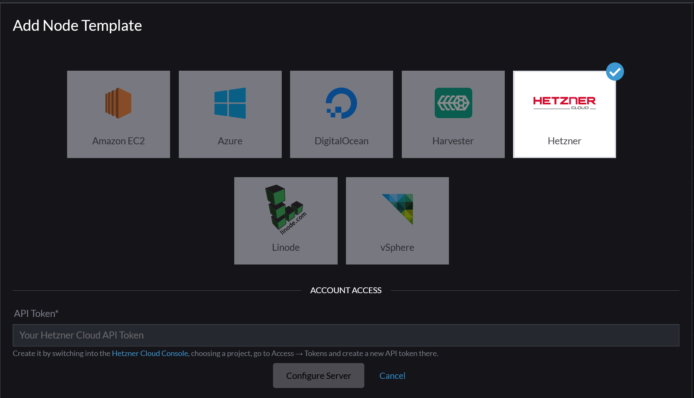
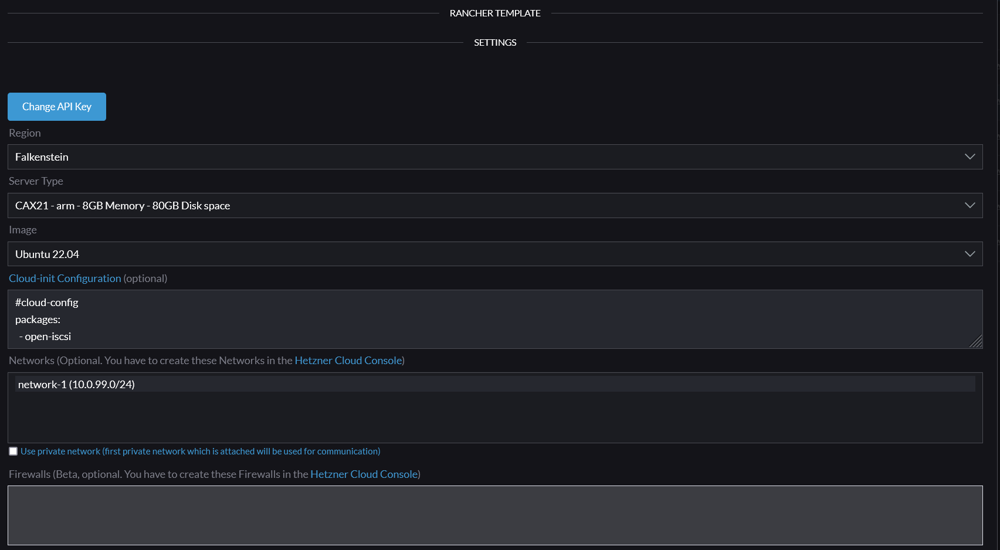

# Rancher 2 Hetzner Cloud UI Driver

> [!WARNING]
> ## ⚠️ Deprecated — please migrate to a v3 UI Extension
>
> **This project is deprecated, no longer maintained, and does not work on
> current Rancher.**
>
> ### Why it no longer works
>
> This driver ships its UI as a compiled Ember `component.js` that Rancher loaded
> through the legacy **"Custom UI URL"** node-driver field. Rancher replaced its
> Ember dashboard with a Vue 3 dashboard and moved all node-driver UIs to the new
> [Rancher UI Extensions](https://extensions.rancher.io/) (v3) framework. The old
> "Custom UI URL" injection point no longer renders these Ember bundles.
>
> Tested on **Rancher v2.14.2**: the driver binary still registers and "Hetzner"
> still appears in the cluster-creation grid, but selecting it shows a **generic
> key/value credential editor instead of this driver's custom form** — so the
> bespoke UI is effectively dead. It also never supported RKE2/K3s provisioning
> (see [#137](https://github.com/mxschmitt/ui-driver-hetzner/issues/137),
> [#145](https://github.com/mxschmitt/ui-driver-hetzner/issues/145),
> [#132](https://github.com/mxschmitt/ui-driver-hetzner/issues/132)).
>
> ### Since when / use this instead
>
> The Vue dashboard became Rancher's default in **2.6** and the legacy Ember UI
> was phased out through 2.6/2.7; the v3 UI Extensions framework is the supported
> model from **Rancher 2.9/2.10 onward**.
>
> ➡️ **Use [`bluquist/rancher-node-driver-hetzner`](https://github.com/bluquist/rancher-node-driver-hetzner)**
> — an actively maintained Rancher **v3 UI Extension** (Vue 3, built on the
> official [`rancher/ui-plugin-examples`](https://github.com/rancher/ui-plugin-examples/tree/main/pkg/node-driver)
> node-driver pattern), requires **Rancher ≥ 2.10**, supports **RKE2/K3s**, and
> handles the API token more securely (it proxies calls through Rancher's
> credential store instead of sending the raw token from your browser).
>
> Install it via **Extensions → Manage Repositories** (add
> `https://bluquist.github.io/rancher-node-driver-hetzner/`), then apply its
> NodeDriver YAML (per its README — add it via YAML, **not** the UI). It pairs
> with the maintained driver-binary fork
> [`bluquist/docker-machine-driver-hetzner`](https://github.com/bluquist/docker-machine-driver-hetzner).
>
> The instructions below are retained for historical reference (Rancher ≤ 2.5).

Rancher 2.X UI driver for the [Hetzner Cloud](https://www.hetzner.de/cloud). For the Rancher 1 version check out the readme from the `v1.6` branch which you can find [here](https://github.com/mxschmitt/ui-driver-hetzner/blob/v1.6/README.md).

## Usage

* Add a Machine Driver in Rancher 2 (`Cluster Management` -> `Drivers` -> `Node Drivers`)

| Key | Value |
| --- | ----- |
| Download URL | `https://github.com/JonasProgrammer/docker-machine-driver-hetzner/releases/download/3.3.0/docker-machine-driver-hetzner_3.3.0_linux_amd64.tar.gz` |
| Custom UI URL | `https://storage.googleapis.com/hcloud-rancher-v2-ui-driver/component.js` |
| Whitelist Domains |  `storage.googleapis.com` |

* Wait for the driver to become "Active"
* Go to Clusters -> Add Cluster, your driver and custom UI should show up.

## Compatibility

The following `component.js` is always compatible with the latest Rancher 2.X version:

`https://storage.googleapis.com/hcloud-rancher-v2-ui-driver/component.js`

### Rancher 2.0

Use this `component.js` to support Rancher 2.0 version:

`https://storage.googleapis.com/hcloud-rancher-v2-ui-driver/component-v20.js`

## Tested linux distributions

To use `Debian` e.g. with a non default Storage Driver, you have to set it manually in the Engine Options of the Node Template in Rancher.

### Recommend

| Image        | Docker Version                     | Docker Storage Driver  |
|--------------|------------------------------------|------------------------|
| Ubuntu 18.04 | 18.06                              | overlay2 (default)     |
| Ubuntu 16.04 | 18.06                              | aufs (default)         |
| Debian 9     | 18.06                              | overlay2, overlay      |
| CentOS 7     | 18.06                              | devicemapper (default) |
| Fedora 27    | not supported (due docker-install) |                        |
| Fedora 28    | not supported (due docker-install) |                        |

## Development

This package contains a small web-server that will serve up the custom driver UI at `http://localhost:3000/component.js`. You can run this while developing and point the Rancher settings there.
* `npm start`
* The driver name can be optionally overridden: `npm start -- --name=DRIVERNAME`
* The compiled files are viewable at http://localhost:3000.
* **Note:** The development server does not currently automatically restart when files are changed.

## Building

For other users to see your driver, you need to build it and host the output on a server accessible from their browsers.

* `npm run build`
* Copy the contents of the `dist` directory onto a webserver.
  * If your Rancher is configured to use HA or SSL, the server must also be available via HTTPS.

## Useful resources

### `Error creating machine: Error running provisioning: ssh command error:`

Try to use `overlay2` and if it does not work `overlay` as `Storage Driver` in the `Engine Options` in the bottom.

### How secure is the `Private Network` feature?

> Traffic between Cloud Servers inside a Network is private and isolated, but not automatically encrypted. We recommend you use TLS or similar protocols to encrypt sensitive traffic.

Reference: [Hetzner Cloud documentation](https://wiki.hetzner.de/index.php/CloudServer/en#Is_traffic_inside_Hetzner_Cloud_Networks_encrypted.3F)

The Rancher traffic between the agents and the Rancher related traffic to the nodes is fully encrypted over HTTPS/TLS.

The custom application specific traffic is *not* encrypted. You can use e.g. the Weave CNI-Provider for that: https://rancher.com/docs/rancher/v2.x/en/faq/networking/cni-providers/#weave

### Requirements for Private Networks

- Rancher host needs to be in the *same Private Network* as the selected one in the Node template
- Under the global settings of Rancher the `server-url` needs to be the internal IP of the Private Network (you can find it in the Hetzner Cloud Console). Otherwise the traffic won't go through the Internal network.

### How to close the open ports on the public interface?

You could use it e.g. in combination with that tool: https://github.com/vitobotta/hetzner-cloud-init
